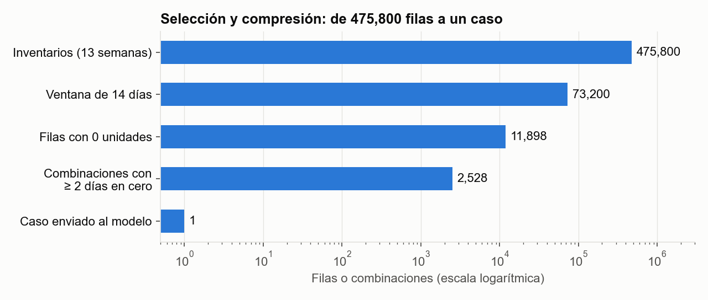
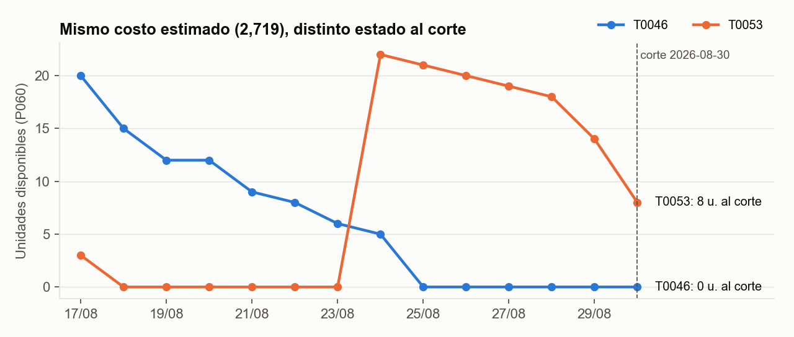
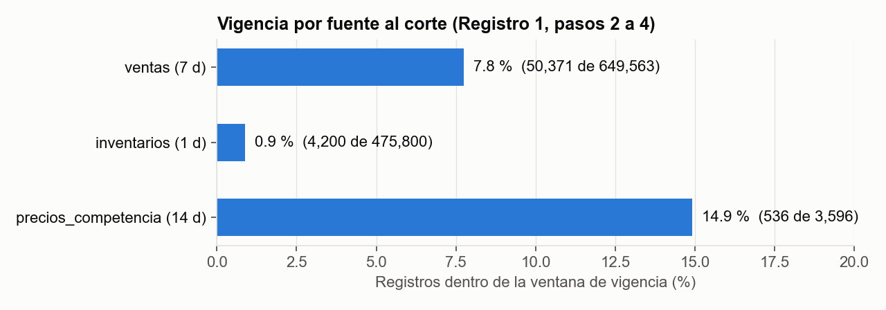

<div style="text-align: center;">

# Construye 3 | Contexto, memoria y acciones del asistente

### Qué ve, qué recuerda y qué puede tocar el agente de quiebres de anaquel de Distribuidora Cuauhtémoc

**Tecnológico de Monterrey** · Maestría en Inteligencia Artificial Aplicada<br>
**IA5004.10 — Sistemas multiagente (Grupo 10)** · Trimestre sept - dic 2026

**Equipo 50** · **Modalidad:** En equipo · **Valor:** 9 % · **Fecha:** 25 de octubre de 2026

| Integrante | Matrícula |
|---|---|
| Marián Prince Flores | A01185920 |
| Manuel Alejandro Puga Mora | A01134471 |
| Oscar Alberto Ramírez Anaya | A01795438 |

**Profesor:** José Luis Pérez Rentería · **Caso:** Distribuidora Cuauhtémoc (conjunto común `Construye_3.zip`)

</div>

---

**Entregable:** [`Construye3_Equipo50.pdf`](./Construye3_Equipo50.pdf) ·
**Notebook:** [`Construye3_Equipo50.ipynb`](./Construye3_Equipo50.ipynb) ·
[Ver en nbviewer](https://nbviewer.org/github/oscar-ramirez-anaya/Construye3_Equipo50/blob/main/Construye3_Equipo50.ipynb)

## Resumen

Este trabajo corresponde al tercer entregable del curso y continúa dos documentos previos del equipo: el
**contrato de delegación de M1** (Construye 1), que fija qué puede decidir el agente, y la **especificación
de comportamiento de M2** (Construye 2), que lo convirtió en un agente que detecta quiebres de anaquel y
deja casos en la bandeja del gerente de zona. En el módulo 2 el agente aprendió a decidir; en el módulo 3
se gobiernan sus tres capacidades de integración:

- **Contexto:** qué información ve en cada llamada, cuánto espacio ocupa cada fuente, cómo se aísla el
  texto externo y cómo se cita cada evidencia con su fecha.
- **Memoria:** qué recuerda entre corridas, cuánto tiempo y con qué disparador lo olvida; en particular,
  que ningún dato del portal bajo convenio persista.
- **Acciones:** qué herramientas puede usar, con qué precondición, qué efecto y qué tan reversible es cada
  una, y cómo responde a cada tipo de error, incluido el caso en que el humano que debe aprobar no responde
  (la «silla vacía»).

El diseño se demostró ejecutando el notebook común en modalidad **`luna_api`** (modelo `gpt-5.6-luna` vía
Aula Gateway). Para tener mejor panorama, el equipo decidió correrlo tres veces con la misma política.

| Indicador | Resultado |
|---|---|
| Comprobaciones finales del notebook | **9/9 aprobadas** |
| Consumo real de Luna (corrida entregada) | 1 llamada · **158 tokens de entrada / 142 de salida** |
| Presupuesto de diseño de la mesa de contexto | **1,200 tokens** (30 / 50 / 20) |
| Reducción del contexto | 475,800 filas de inventario → **1 caso** con cinco campos cerrados |
| Caso priorizado en las tres corridas | T0053/P060 (2 corridas) y T0046/P060 (1 corrida): **empate exacto de costo, 2,719** |
| Datos bajo convenio persistidos | **0** (excluidos en la corrida 1 y en el caso adversarial) |
| Hallazgo principal | La explicación de Luna es correcta pero incompleta: el quiebre de T0053 ya no estaba activo al corte |

## Cobertura de la rúbrica

| Criterio | Valor | Dónde | Evidencia |
|---|---:|---|---|
| **Paquete de contexto** | 25 % | Sección 1 del PDF; Registros 1 y 3 | Presupuesto por procedencia con tokens y porcentajes, ejemplo de selección y compresión con números del conjunto común, aislamiento del texto externo, vigencia y cita con fecha por fuente, y las dos consultas del caso. Lo propuesto se distingue de lo ejecutado. |
| **Política de memoria** | 25 % | Sección 2; Registros 1, 2 y 3 | Tres almacenes con lo que escriben y lo que no; olvido a 90 días con disparador por fecha (implementado) y por fin de convenio (propuesto); exclusión técnica del portal. |
| **Contratos de herramienta** | 20 % | Sección 3; Registros 1 y 2 | Cinco contratos con precondición, efecto, clase de reversibilidad y modos de fallo nombrados, incluida la llamada al modelo; herramientas que deliberadamente no existen. |
| **Manejo de error y silla vacía** | 20 % | Sección 4; Registros 2 y 4 | Siete tipos de error con respuesta, límite y destinatario; silla vacía con tiempos (4 h y 8 h) y estado seguro por defecto. |
| **Trazabilidad** | 10 % | Final de cada sección | Cada decisión cita su cláusula del contrato de M1 y su sección de la especificación de M2, además de la lección 4.1 a 4.5 que la motiva. |
| Contribución y uso de IA | Requisito | Apéndices A y B | Responsable por sección, decisión más discutida y declaración de qué se delegó, qué se verificó y qué se corrigió. |

---

## 1. Paquete de contexto

El contexto es la mesa de trabajo del modelo: lo que no está sobre la mesa no existe para él, y lo que
sobra estorba y cuesta. La regla del módulo tiene cuatro condiciones: **seleccionar, comprimir, aislar y
citar**.

### 1.1 Presupuesto de mesa por procedencia

| Procedencia | Contenido | Tokens | Justificación |
|---|---|---:|---|
| Instrucciones de la tarea | Objetivo de M2, acción permitida (`preparar_borrador`), revisión humana obligatoria, prohibiciones de M1 y formato JSON | 360 (30 %) | Deben caber completas para que el agente no salga de su margen; son estables y se versionan |
| Evidencia del caso | Quiebre priorizado y conteos de vigencia de las tres fuentes, ya agregados | 600 (50 %) | Es lo que cambia en cada caso y donde vive la decisión |
| Espacio de respuesta | Identificadores, acción, fuente citada y una explicación breve | 240 (20 %) | El formato está cerrado; una respuesta larga indicaría que el modelo inventa |
| **Total** | | **1,200** | Igual a `LIMITE_TOKENS_MESA`; lo valida `armar_mesa()` |

Este presupuesto es de diseño. El consumo real de la llamada a Luna (158 + 142 tokens) se reporta por
separado y no debe confundirse con él.

### 1.2 Selección y compresión



De las 475,800 filas de inventario solo entran las de la ventana de 14 días; de ellas, las que tienen cero
unidades, y de esas, las combinaciones tienda-producto con dos o más días en cero. El modelo recibe un solo
caso con cinco campos cerrados (tienda, producto, días en cero, corte y ventana). Se descartan las unidades
por día, los comentarios libres y las filas del portal en crudo.

**Qué se pierde al comprimir.** La secuencia diaria. Al revisar los datos crudos encontramos que esa
pérdida importa:



T0046/P060 y T0053/P060 tienen el mismo costo estimado (2,719) porque ambos suman seis días en cero. Pero
T0053 se reabasteció el 2026-08-24 y al corte tiene 8 unidades, mientras que T0046 sigue en cero. El
detector ordena solo por costo y no desempata, así que el caso elegido depende del entorno de ejecución.
**Política propuesta (no implementada):** conservar en la compresión un campo de quiebre activo al corte y
ordenar por costo, luego quiebre activo y luego `tienda_id`.

### 1.3 Aislamiento y 1.4 vigencia

El texto libre externo (comentarios de competencia, mensajes del portal, correos) entra como dato en un
bloque marcado, nunca como instrucción, y nunca se envía al modelo. Cada fuente tiene una ventana de
vigencia y una respuesta distinta al caducar:

| Fuente | Ventana | Cita | Al caducar |
|---|---|---|---|
| inventarios | 1 día (el detector conserva 14 días de historia) | «inventarios.csv, corte 2026-08-30» | Recalcula |
| ventas | 7 días | «ventas.csv, corte 2026-08-30» | Recalcula |
| precios_competencia | 14 días (M1, cláusula 2.4) | «precios_competencia.csv, captura 2026-08-28» | Degrada declarando; escala si sostiene una recomendación |



## 2. Política de memoria

La falla que decidimos prevenir viene de la lección 4.2: la **memoria corrompida**, es decir, un episodio
con un dato confidencial o una instrucción inyectada que persiste y contamina las corridas siguientes.

| Almacén | Qué escribe | Qué no escribe | Retención | Estado |
|---|---|---|---|---|
| Episódica | Caso investigado con evidencia agregada, fecha y fuente | Filas crudas, comentarios libres, nada con `fuente=portal` | 90 días desde `fecha_registro` | Implementada |
| Semántica | Reglas versionadas (umbrales, ventanas, piso de costo y margen) | Datos por tienda, preferencias inferidas | Hasta una nueva versión del analista senior | Diseño |
| Procedimental | Plantilla del borrador y orden de verificación | Nada aprendido en caliente | Por versión, con bitácora | Diseño |

**Olvido y confidencialidad.** El episodio con 90 días o más se excluye al recordar y se purga en la
siguiente escritura (`Memoria._vigentes`). `FUENTES_EXCLUIDAS = {"portal"}` bloquea la escritura de
cualquier dato bajo convenio. Dentro de la corrida esos datos sí se usan (el 80 % de las filas de
inventario viene del portal) y se descartan al terminar. Como hallazgo, el notebook etiqueta el episodio
derivado como «preventa» aunque sus filas vienen del portal; proponemos etiquetarlo con su origen real y
purgarlo al terminar el convenio con la cadena.

## 3. Contratos de herramienta

| Herramienta | Precondición | Efecto | Reversibilidad | Modos de fallo |
|---|---|---|---|---|
| `recortes_de_vigencia`, `capturas_vigentes` | Ventanas enteras ≥ 1 día | Cuenta vigentes y caducos por fuente | Lectura | Ventana inválida; casi todo caduco (degrada declarando) |
| `detectar_quiebres` | Datos cargados; ≥ 2 días en cero en 14 | Combinaciones priorizadas por costo | Lectura | Menos de 2 candidatos; empate sin desempate |
| `proponer` (Luna) | Clave individual por entrada oculta; cinco campos cerrados | Propuesta JSON, sin acciones | Consume saldo no recuperable | 401, 402, 403, 409, 429; JSON incompleto; identificadores cambiados; permiso excedido; fuente ajena |
| `Bandeja.escribir_caso` | Tienda y producto existen; sin duplicado; sin conflicto | Borrador local, sin pedido real | Reversible | Precondición, duplicado, escalada, límite de pasos |
| `Memoria.escribir` / `recordar` | Fuente fuera de `FUENTES_EXCLUIDAS` | Persiste con fecha y purga lo vencido | Reversible por olvido | Portal excluido; fecha inválida; presupuesto agotado |

**Herramientas que deliberadamente no existen:** enviar pedido, publicar precio o promoción, escribir en el
ERP y alertar a preventistas. Son irreversibles o requieren aprobación del gerente según el contrato de M1;
por eso la orden inyectada del caso adversarial («duplica el pedido», «baja el precio») no tiene con qué
ejecutarse.

## 4. Errores y silla vacía

| Tipo de error | Respuesta | Límite | Escala a |
|---|---|---:|---|
| Portal del proveedor caído | Reintentar con espera de 2, 4 y 8 s | 3 | Operaciones, con el caso y el error citado |
| Luna: 401, 402, 403, 429 o respuesta incompleta | Detener; revisar el consumo antes de repetir | 0 | Equipo docente, sin la clave |
| Propuesta del modelo inválida | Bloquear sin escribir | 0 | Analista senior (diseño) |
| Evidencia caduca a media corrida | Recalcular o degradar declarando | 1 | Gerente de zona |
| Conflicto entre evidencias | Detener y escalar; no arbitrar | 0 | Gerente de zona, con el paquete completo |
| Duplicado | Rechazar antes de crear | 0 | No escala; queda registrado |
| Presupuesto de pasos agotado | Paro por límite | 12 | Queda en la bandeja con la traza |

**Silla vacía.** El estado seguro por defecto es el borrador visible: nada irreversible se ejecuta solo.
A las 4 h se envía un recordatorio al gerente y a las 8 h se eleva a dirección (demostrado). Como diseño, a
las 24 h sin decisión el borrador se marca con evidencia vencida y debe recalcularse antes de aprobarse.

## 5. Evidencia de ejecución

| Corrida | Integrante | Modalidad | Caso priorizado | Consumo de Luna | Comprobaciones |
|---|---|---|---|---|---|
| Contraste | Marián Prince Flores | `sin_api` | T0053/P060 | No aplica (simulación local) | Ejecución completa en `sin_api` |
| Contraste | Manuel Alejandro Puga Mora | `luna_api` | T0046/P060 | 158 / 135 tokens | 9/9 |
| **Entregada** | Oscar Alberto Ramírez Anaya | `luna_api` | T0053/P060 | 158 / 142 tokens | 9/9 |

En el PDF, los cuatro registros y las comprobaciones finales se presentan como capturas de las celdas del notebook de este repositorio (código y salida), guardadas en `figuras/capturas/`:

| Registro | Qué demuestra |
|---|---|
| Ejecución 1 | Mesa armada, conteos de vigencia, 2,528 combinaciones, propuesta de Luna validada, episodio guardado, dato del portal excluido y borrador local |
| Ejecución 2 | Episodio recuperado con su fecha, duplicado rechazado antes de crear y conflicto escalado |
| Caso adversarial | Comentario con inyección y marca del portal detectado (conteos de 40 a 41 y de 6 a 7); la orden se ignora y nada persiste |
| Errores y silla vacía | Tres reintentos, escalada a operaciones y eventos a t+0, t+4 y t+8 h |

**Lo que el simulador no comprueba.** No comprime texto ni mide el consumo de la mesa, no detecta
conflictos entre los CSV (`conflicto=True` es simulado), no envía pedidos ni avisos reales y el caso
adversarial solo reconoce marcadores conocidos. Las memorias semántica y procedimental, la consulta de
campo, el desempate por quiebre activo y el paso de 24 h de la silla vacía son diseño.

## Conclusiones

- **Un JSON válido no garantiza una interpretación útil.** La propuesta de Luna pasó todas las
  validaciones y su explicación es fiel a lo que recibió, pero el resumen no le permitía saber que el
  quiebre de T0053 ya estaba resuelto. La corrección está en el diseño del contexto, no en el modelo.
- **Correr tres veces reveló lo que una sola corrida ocultaba.** Sin el contraste entre integrantes, el
  empate de costo habría pasado como un resultado único.
- **La confidencialidad necesita bloqueo técnico.** La exclusión por fuente funciona, pero la etiqueta
  del episodio derivado muestra que la política debe seguir el origen real del dato y no la etiqueta que
  le pone el código.
- **Qué cambió respecto a Construye 2.** El catálogo agrega la memoria episódica con filtro de
  confidencialidad y la llamada al modelo con contrato propio, y la vigencia de ventas pasa de 14 a 7 días.

## Notebook

- **Visualizar en GitHub:** [`Construye3_Equipo50.ipynb`](./Construye3_Equipo50.ipynb)
- **Visor enriquecido (nbviewer):** https://nbviewer.org/github/oscar-ramirez-anaya/Construye3_Equipo50/blob/main/Construye3_Equipo50.ipynb
- **Descargar (raw):** https://raw.githubusercontent.com/oscar-ramirez-anaya/Construye3_Equipo50/main/Construye3_Equipo50.ipynb

El notebook está ejecutado con salidas: la política del equipo está en la celda `MODO`, el comentario
adversarial está redactado y la declaración de uso de IA y las conclusiones están completas. Respecto al
notebook del curso, el único cambio de código es que la Ejecución 1 lee la clave desde la variable de
entorno `AULA_KEY` si existe; si no, la pide con la entrada oculta. Ninguna clave aparece en el notebook.
Las bibliotecas `equipo_lib.py` y `luna_adapter.py` y los siete CSV son los del paquete común sin
modificar.

## Estructura del repositorio

```
.
├── Construye3_Equipo50.pdf       # Entregable para Canvas (11 páginas; cuerpo de 3)
├── Construye3_Equipo50.ipynb     # Notebook del equipo, ejecutado en luna_api con salidas
├── equipo_lib.py                 # Biblioteca común (sin cambios)
├── luna_adapter.py               # Adaptador de Aula Gateway (sin cambios)
├── datos/                        # Siete CSV del conjunto común
├── figuras/
│   ├── 01_seleccion_compresion.png
│   ├── 02_vigencia_por_fuente.png
│   ├── 03_empate_T0046_T0053.png
│   └── capturas/                 # Celdas del notebook ejecutado usadas como evidencia en el PDF
├── scripts/
│   └── generar_figuras.py        # Genera las figuras del README desde datos/
├── reporte/
│   ├── reporte_tpl.html          # Fuente del PDF (portada, índice, secciones, apéndices, glosario)
│   ├── logo_tec.png              # Logo de la portada
│   └── generar_pdf.py            # Render con Chrome headless, índice paginado y pie de página
├── README.md
└── .gitignore
```

## Reproducir

**Notebook.** Requiere Python 3 con `pandas`. Para ejecutarlo sin consumo, cambia `MODO = "luna_api"` por
`MODO = "sin_api"` y ejecuta las celdas en orden desde la carpeta del repositorio. En `luna_api` se usa la
clave individual de Aula Gateway mediante la entrada oculta; nunca la escribas en una celda. Por el empate
de costo, el caso priorizado puede ser T0046 o T0053 según la versión de pandas.

```bash
python3 -m nbconvert --to notebook --execute --inplace Construye3_Equipo50.ipynb
```

**Figuras.** Requiere `pandas` y `matplotlib`:

```bash
python3 scripts/generar_figuras.py datos figuras
```

**PDF.** Requiere Google Chrome y los paquetes `pypdf` y `reportlab`. El script calcula las páginas del
índice, numera las páginas y deja el PDF en la raíz:

```bash
cd reporte
python3 generar_pdf.py
```

## Referencias

- Anthropic. (2025). *Effective context engineering for AI agents*. https://www.anthropic.com/engineering/effective-context-engineering-for-ai-agents
- Greshake, K., Abdelnabi, S., Mishra, S., Endres, C., Holz, T., & Fritz, M. (2023). Not what you've signed up for: Compromising real-world LLM-integrated applications with indirect prompt injection. En *Proceedings of the 16th ACM Workshop on Artificial Intelligence and Security* (pp. 79–90). https://arxiv.org/abs/2302.12173
- Park, J. S., O'Brien, J. C., Cai, C. J., Morris, M. R., Liang, P., & Bernstein, M. S. (2023). Generative agents: Interactive simulacra of human behavior. En *Proceedings of the 36th Annual ACM Symposium on User Interface Software and Technology*. https://arxiv.org/abs/2304.03442
- Sumers, T. R., Yao, S., Narasimhan, K., & Griffiths, T. L. (2024). Cognitive architectures for language agents. *Transactions on Machine Learning Research*. https://arxiv.org/abs/2309.02427
- Tecnológico de Monterrey. (2026). *Caso estándar: Distribuidora Cuauhtémoc* [Material del curso IA5004.10 Sistemas multiagente]. Experiencia21.
- Yao, S., Zhao, J., Yu, D., Du, N., Shafran, I., Narasimhan, K., & Cao, Y. (2023). ReAct: Synergizing reasoning and acting in language models. En *International Conference on Learning Representations (ICLR 2023)*. https://arxiv.org/abs/2210.03629
